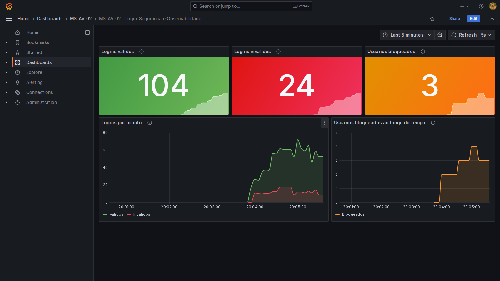
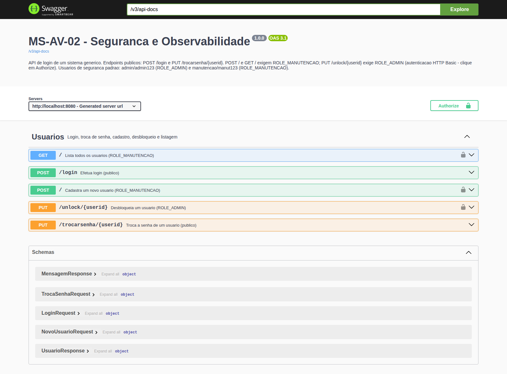

# MS-AV-02 – Segurança e Observabilidade

Mecanismo de login de um sistema genérico em **Spring Boot 3.4 (Java 17)**, padrão RESTful, com:

- **Spring Security** + **JdbcUserDetailsManager** para proteger endpoints por role (`ROLE_ADMIN`, `ROLE_MANUTENCAO`)
- **Bloqueio de usuário** após mais de uma falha de login (tabela `login_attempts`)
- **Indicadores** (Micrometer/Prometheus): logins válidos, logins inválidos e total de usuários bloqueados
- **Dashboard no Grafana** com os três indicadores
- **OpenAPI 3 + Swagger UI** (springdoc)

## Dashboard no Grafana



- Dashboard exportado (Share → Export → *Export for sharing externally*): [`observabilidade/grafana/dashboard-exportado.json`](observabilidade/grafana/dashboard-exportado.json)
- Versão usada no provisionamento automático: [`observabilidade/grafana/dashboards/ms-av-02-login.json`](observabilidade/grafana/dashboards/ms-av-02-login.json)

## Endpoints

| Método | Endpoint | Acesso | Corpo | Respostas |
|---|---|---|---|---|
| `POST` | `/login` | público | `{"username":"","senha":""}` | `200` válido · `401` inválido ou bloqueado |
| `PUT` | `/trocarsenha/{userid}` | público | `{"atual":"","nova":""}` | `200` · `401` senha atual não confere · `404` · `423` bloqueado |
| `POST` | `/` | `ROLE_MANUTENCAO` | `{"username":"","senha":""}` | `201` · `409` já existe · `401` · `403` |
| `PUT` | `/unlock/{userid}` | `ROLE_ADMIN` | – | `200` · `404` · `401` · `403` |
| `GET` | `/` | `ROLE_MANUTENCAO` | – | `200` lista JSON · `401` · `403` |

Os endpoints protegidos usam **HTTP Basic**. Usuários de segurança criados na subida (tabelas `users`/`authorities` do `JdbcUserDetailsManager`):

| Usuário | Senha | Role |
|---|---|---|
| `admin` | `admin123` | `ROLE_ADMIN` |
| `manutencao` | `manut123` | `ROLE_MANUTENCAO` |

Usuários de exemplo do sistema (tabela `usuarios`, via `data.sql`): `maria/maria123`, `joao/joao123`, `ana/ana123`.

### Regra de bloqueio
1. Cada senha errada incrementa `login_attempts.failed_attempts`.
2. Na **segunda** falha (mais de uma) o usuário recebe `locked = TRUE` e `locked_at`.
3. Usuário bloqueado recebe `401` mesmo com a senha correta, até um admin chamar `PUT /unlock/{userid}`.
4. Um login válido zera o contador de falhas.

## Indicadores

Expostos em `GET /actuator/prometheus`:

| Métrica | Tipo | Significado |
|---|---|---|
| `login_validos_total` | counter | logins que retornaram 200 |
| `login_invalidos_total` | counter | logins que retornaram 401 (senha errada, usuário inexistente ou bloqueado) |
| `login_usuarios_bloqueados` | gauge | `COUNT(*)` de `login_attempts` com `locked = TRUE` |

## Swagger / OpenAPI

- Swagger UI: http://localhost:8080/swagger-ui.html
- Especificação: http://localhost:8080/v3/api-docs



## Como executar

### Opção 1 – tudo com Docker (app + Prometheus + Grafana)
```bash
docker compose up --build
./scripts/gerar-trafego.sh        # popula o dashboard
```
- API: http://localhost:8080 · Prometheus: http://localhost:9090 · Grafana: http://localhost:3000 (admin/admin)
- O dashboard aparece em **Dashboards → MS-AV-02**.

### Opção 2 – aplicação na IDE / Maven, observabilidade no Docker
```bash
./mvnw spring-boot:run                     # Windows: mvnw.cmd spring-boot:run
docker compose up prometheus grafana       # o Prometheus coleta de host.docker.internal:8080
```

### Testes
```bash
./mvnw test     # 10 testes de integração cobrindo todos os requisitos
```

### Exemplos com curl
```bash
curl -i -X POST localhost:8080/login -H "Content-Type: application/json" -d '{"username":"maria","senha":"maria123"}'
curl -i -X PUT localhost:8080/trocarsenha/maria -H "Content-Type: application/json" -d '{"atual":"maria123","nova":"nova123"}'
curl -i -u manutencao:manut123 -X POST localhost:8080/ -H "Content-Type: application/json" -d '{"username":"carlos","senha":"carlos123"}'
curl -i -u manutencao:manut123 localhost:8080/
curl -i -u admin:admin123 -X PUT localhost:8080/unlock/maria
```

## Estrutura
```
src/main/java/br/espm/ms/login
├── config/        SecurityConfig (roles + JdbcUserDetailsManager), OpenApiConfig
├── controller/    UsuarioController (5 endpoints)
├── dto/           records de entrada e saída
├── exception/     tratamento de erros de validação
├── metrics/       LoginMetrics (counters + gauge)
├── repository/    UsuarioRepository, LoginAttemptRepository (JdbcTemplate)
└── service/       UsuarioService (regras de login, bloqueio e troca de senha)
src/main/resources  application.yml, schema.sql, data.sql
observabilidade/    prometheus.yml, provisionamento e dashboards do Grafana
scripts/            gerar-trafego.sh
docs/               prints do Grafana e do Swagger
```

## Observações
- O script SQL do enunciado tinha uma vírgula sobrando antes do `)` da tabela `login_attempts`; foi corrigido em `schema.sql`.
- A coluna `usuarios.senha` é `VARCHAR(10)`, então as senhas do sistema genérico ficam em texto puro (não cabe um hash BCrypt). Os usuários de segurança (`admin`, `manutencao`) usam BCrypt.
- O `GET /` não devolve a senha, apenas `username`, `bloqueado` e `tentativasFalhas`.
- Banco H2 em memória: os dados voltam ao estado inicial a cada reinício, e os contadores de login também.
